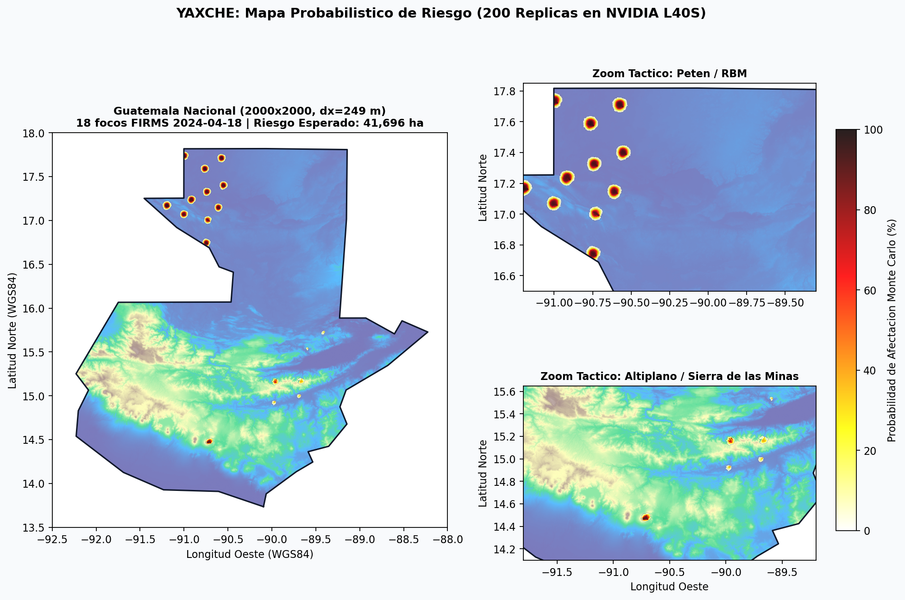
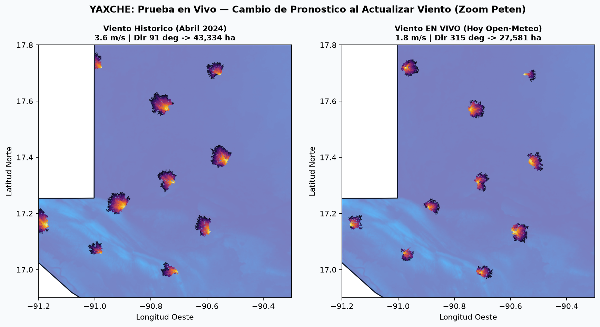
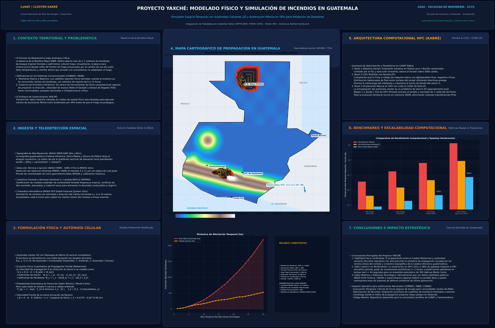

# YAXCHÉ

Simulador de propagación de incendios forestales sobre Guatemala, implementado en Python y acelerado con **Numba** (CPU multihilo) y **CuPy/CUDA** (GPU).

El objetivo del proyecto es proyectar en segundos hacia dónde avanzará un incendio en las próximas 48 horas usando topografía satelital, viento real y focos de calor detectados por satélite, y estimar zonas de mayor riesgo mediante simulaciones Monte Carlo.



---

## Cómo está pensado el modelo

En lugar de trabajar sobre un mapa plano genérico, el territorio de Guatemala se discretiza en una malla georreferenciada (`WGS84`) de **`2000 x 2000` celdas** (`~249 m` por celda). Cada paso simula 1 hora de propagación evaluando para cada celda encendida sus 8 vecinas según tres factores:

- **Topografía y cuerpos de agua:** elevación real descargada de AWS Terrain Tiles (DEM); las pendientes ascendentes aceleran el avance y los lagos (Atitlán, Izabal, Petén Itzá) detienen el frente.
- **Viento:** vectores `u, v` obtenidos de Open-Meteo (histórico o en vivo). El viento deforma el frente en dirección al flujo del aire en lugar de expandir círculos uniformes.
- **Ignición inicial:** focos reales de alta confianza tomados de **NASA FIRMS (VIIRS)** (por ejemplo, los 18 focos activos del `2024-04-18` distribuidos entre Petén, Sierra de las Minas y la Cadena Volcánica).

Como el viento nunca es exacto a 48 horas vista, el simulador ejecuta **200 réplicas Monte Carlo** perturbando dirección y velocidad en cada corrida para obtener un mapa de probabilidad de afectación por hectárea.

---

## Rendimiento en Kabré (CPU vs GPU)

Las mediciones se ejecutaron en el nodo `nukwa-06.cnca` del clúster Kabré (CeNAT) con una **NVIDIA L40S** (Job `634819`). Sobre la malla real de `2000 x 2000` (4 millones de celdas, 48 pasos):

| Implementación | Mediana (48 pasos) | Speedup vs 1 hilo |
| --- | ---: | ---: |
| CPU Numba (1 hilo) | `1,126.98 ms` | `1.0x` |
| CPU Numba (2 hilos) | `636.73 ms` | `1.77x` |
| CPU Numba (4 hilos) | `435.76 ms` | `2.59x` |
| GPU L40S (end-to-end con copias H2D/D2H) | `19.974 ms` | `56.4x` |
| GPU L40S (solo kernel, memoria coalescente) | `1.103 ms` | `1,021.7x` |

Todas las variantes (Numba CPU con 1, 2 y 4 hilos, y CUDA GPU coalescente/strided) producen exactamente **`7,001` celdas afectadas** para la misma semilla, verificando equivalencia numérica entre CPU y GPU. El ensamble completo de **200 réplicas Monte Carlo** tomó **`11.11 s`** (`55.5 ms` por réplica).

### Notas de implementación y calibración

- **Acceso coalescente vs *strided* en CUDA:** al mapear `threadIdx.x` a columnas contiguas de memoria en `src/simulation_gpu.py`, el tiempo de kernel en `2000 x 2000` bajó de `4.259 ms` (*strided* `16x16`) a `1.103 ms` (`32x8` coalescente). En una malla de `4500 x 4500` (`20.25M` celdas) bajó de `46.27 ms` a `24.90 ms`.
- **Calibración por tamaño de celda:** en las primeras pruebas sobre `450 x 450` (`~1.1 km` por celda), una probabilidad fija por paso producía perímetros sobredimensionados e isotrópicos. Escalar `p_base` inversamente con `cell_size` y aumentar el peso direccional del viento (`c_wind = 0.35`) corrigió la escala física en hectáreas y la forma elíptica de las plumas.

---

## Sensibilidad con viento en vivo

Para comprobar la respuesta del simulador ante cambios meteorológicos reales, se comparó el avance a 48 horas desde los mismos 18 focos usando el viento seco de abril de 2024 frente al viento en vivo consultado en Open-Meteo:



Con viento del Este (`3.6 m/s`, `91°`) las plumas se alargan hacia el Oeste alcanzando `43,334 ha`; con viento en vivo del Noroeste (`1.8 m/s`, `315°`) cambian `10,259` celdas respecto al caso base y el área proyectada se reduce a `27,581 ha` hacia el Sureste.

---

## Ejecución

### Local (CPU)
```bash
git clone https://github.com/JoseArt777/YAXCHE_WORKSPACE.git
cd YAXCHE_WORKSPACE/YAXCHE
pip install -r requirements.txt

# Simulación secuencial de referencia
python3 run_demo.py

# Generar dataset real de alta resolución (2000x2000, ~249 m/celda)
python3 scripts/build_real_dataset.py --size 2000 --zoom 10 --out data/processed/guatemala_real_2000.npz
```

### En Kabré (GPU NVIDIA L40S)
```bash
module load mamba/Python4HPC
python scripts/benchmark_kabre.py --mode gpu --npz data/processed/guatemala_real_2000.npz --steps 48 --repeat 10 --mc-runs 200
python scripts/benchmark_kabre.py --mode cpu --npz data/processed/guatemala_real_2000.npz --steps 48 --repeat 3
```

---

## Estructura del repositorio

```text
YAXCHE/
├── data/
│   ├── raw/nasa_firms_viirs_guatemala_2024.csv
│   └── processed/guatemala_real.npz
├── jobs/                       # Scripts Slurm para CPU y GPU en Kabré
├── results/                    # JSONL de mediciones y mapas generados
├── scripts/
│   ├── build_real_dataset.py   # Descarga DEM, Open-Meteo y FIRMS
│   └── benchmark_kabre.py      # Suite de benchmarks y Monte Carlo GPU
├── src/
│   ├── terrain.py
│   ├── wind.py
│   ├── simulation.py           # Referencia secuencial
│   ├── simulation_numba.py     # CPU paralelo con Numba
│   ├── simulation_gpu.py       # Kernel CUDA con CuPy
│   └── visualization.py
├── tests/test_simulation.py
├── generate_poster.py
└── run_demo.py
```


